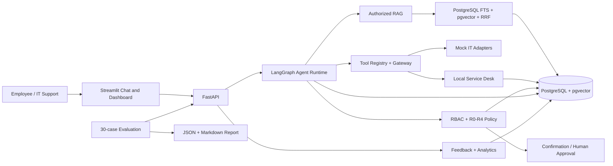
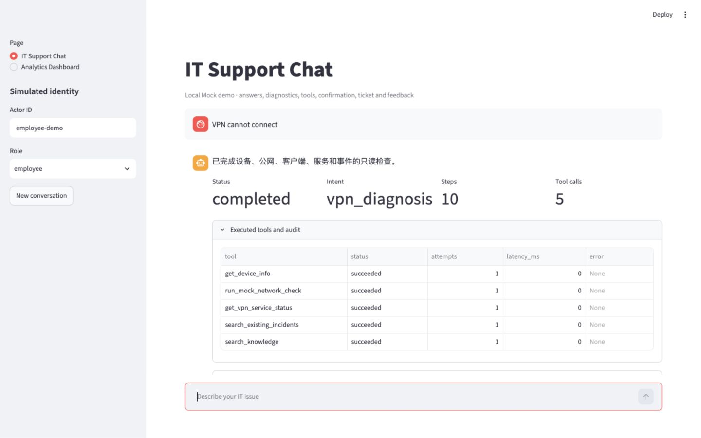
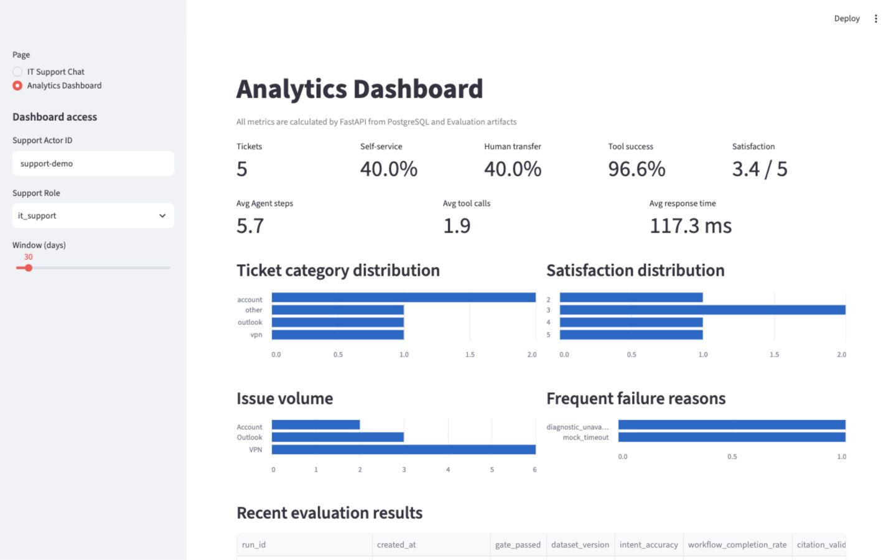

# Enterprise IT Support AI Agent

一个可本地运行、可评估、可审计的企业 IT 支持 AI Agent 作品集项目。它用可信 RAG 回答知识问题，用 LangGraph 编排 VPN、Outlook 和账号诊断，并把所有工具调用、低风险写入、权限策略和人工审批放在确定性代码控制下。

项目使用完全虚构的知识、身份、工单和诊断结果；默认 Fake Model/Fake Embedding 不调用付费 API，也不连接真实企业账户。

## 项目背景与核心业务问题

企业内部 IT 支持通常同时面临三类问题：知识分散导致重复问答，故障诊断步骤不一致，以及自动化操作缺少权限、确认和审计。普通聊天机器人可以生成流畅文字，却不能证明答案来自哪份授权知识，也不能安全决定是否执行工单、账号或权限操作。

本项目把这三个问题拆成一条可验证链路：

- RAG 只使用当前用户有权访问的证据，并返回来源绑定 Citation；
- Agent 用显式 State/Node/Edge 编排诊断，不让模型自由循环；
- Tool Gateway 统一执行注册、Schema、权限、超时、重试和审计；
- R1 写操作需要原用户确认，R3 高风险请求需要授权人审批，R4 永远拒绝；
- 离线 Evaluation 同时检查检索、回答、路由、工具、工作流和禁止动作。

## 系统功能

- 导入并版本化 Markdown、UTF-8 TXT 和可提取文本 PDF；
- PostgreSQL 全文检索 + pgvector 语义检索 + RRF 混合排序；
- 有界 Context、结构化模型输出、无证据拒答和服务器物化 Citation；
- 六类意图：知识问答、VPN/Outlook/账号诊断、工单请求、不支持请求；
- 七个只读 Mock 工具，以及本地工单创建/评论/状态工具；
- R0–R4 风险策略、用户确认、RBAC、Human-in-the-loop 暂停与恢复；
- Agent Run、Step、Tool Execution、Ticket、Approval、Audit 和 Feedback 轨迹；
- Streamlit Chat 与 Analytics Dashboard；
- 30-case Agent Evaluation、回归阈值、previous-run diff 和安全门禁；
- Docker Compose 一键启动与 GitHub Actions CI。

## 架构



一次请求不会让 LLM 直接访问数据库或工具。模型只提供受 Schema 约束的分类或回答草稿；权限、证据过滤、路由、风险、幂等、状态转换、Citation 和审计都由服务器代码决定。

## 技术栈

| 层 | 技术 |
| --- | --- |
| API/UI | FastAPI、Pydantic、Streamlit、HTTPX/Requests |
| Agent/LLM | LangGraph、provider-neutral ModelGateway、OpenAI-compatible Adapter、Fake Provider |
| RAG | PostgreSQL FTS、pgvector、RRF、结构化输出、Citation binding |
| 数据 | PostgreSQL 17、SQLAlchemy 2、Alembic、psycopg |
| 分析 | SQL 聚合、pandas 后端投影 |
| 测试 | pytest、真实 PostgreSQL/pgvector integration、Streamlit AppTest |
| 交付 | Docker Compose、GitHub Actions、Ruff、Gitleaks |

## 项目目录

```text
apps/
  api/                         FastAPI composition root
  ui/                          HTTP-only Streamlit Chat / Dashboard
src/enterprise_it_support/
  agent_runtime/               LangGraph State、Node、Edge、Run/Step
  analytics/                   Feedback、SQL 聚合、Dashboard contract
  conversation/                RAG 会话、消息和 Turn Trace
  evaluation/                  Dataset、Metrics、Runner、Report、Gate
  governance/                  RBAC、R0-R4、Approval、resume
  intelligence/                Model / Embedding Gateway
  knowledge/                   Parser、Chunk、Index、Retrieval、RAG evidence
  platform/                    Settings、Database、structured logging
  service_desk/                Ticket、Confirmation、Audit
  tools/                       Registry、Schema、Policy、Gateway、Mock tools
data/evaluation/               版本化评估集、阈值与虚构知识语料
docker/                        FastAPI / Streamlit Dockerfile
migrations/                    Alembic migrations
scripts/                       Migration、seed、CLI、evaluation、安全检查
tests/                         Unit + PostgreSQL/pgvector integration
docs/                          架构、Phase 报告、演示与面试材料
```

## 快速启动：Docker Compose

要求：Docker Desktop 或兼容的 Docker Engine + Compose。

```bash
cp .env.example .env
docker compose up --build -d
docker compose ps
```

启动顺序由 Compose 控制：

```text
PostgreSQL healthy
→ one-shot migration reaches Alembic head
→ FastAPI /ready succeeds
→ Streamlit starts
```

自动迁移入口只允许单一 Alembic head，只执行前向 `upgrade head`；数据库已在 head 时为 no-op。它不会 downgrade、drop、reset 或 seed，也不会在每个 Uvicorn worker 中重复运行。

打开：

- Streamlit：<http://127.0.0.1:8501>
- FastAPI OpenAPI：<http://127.0.0.1:8000/docs>
- Readiness：<http://127.0.0.1:8000/ready>

生成幂等的虚构演示数据：

```bash
docker compose exec api python -m scripts.seed_phase11_demo
```

停止服务但保留数据卷：

```bash
docker compose down
```

只有在明确需要删除所有本地数据库、知识和评估数据时，才手动使用 `docker compose down --volumes`。

## 本地开发启动

```bash
cp .env.example .env
python3 -m venv .venv
source .venv/bin/activate
python -m pip install --no-build-isolation '.[dev]'
docker compose up -d db
python -m scripts.run_migrations
python -m uvicorn apps.api.main:create_app --factory --reload --no-access-log
```

第二个终端启动 UI：

```bash
IT_SUPPORT_API_BASE_URL=http://127.0.0.1:8000 \
  .venv/bin/python -m streamlit run apps/ui/streamlit_app.py
```

`.env` 已被 Git 忽略；`.env.example` 只包含本机占位值。不要在仓库、截图、日志或 Evaluation 数据中放真实 API Key、员工数据或公司知识。

## 5 分钟 Demo 流程

完整讲稿见 [`docs/demo_script.md`](docs/demo_script.md)。推荐顺序：

1. 询问 VPN 知识问题，展示授权 Retrieval、回答和 Citation；
2. 输入 Outlook 故障，展示显式诊断节点和 Mock Tool observations；
3. 请求创建工单，展示 R1 pending confirmation；
4. 原用户确认后查看 Ticket Number、Tool Execution 和 Audit；
5. 切换 Dashboard，查看工单、解决率、转人工、工具成功率和满意度；
6. 运行 Evaluation，查看 30-case 指标、失败案例和 Gate 结果。

页面快照：





## RAG 实现

```text
Upload
→ parse and normalize
→ immutable Document Version
→ bounded traceable Chunks
→ Fake/OpenAI-compatible Embedding
→ PostgreSQL FTS + pgvector candidates
→ authorization/status/time filtering before ranking
→ RRF
→ Relevance Policy
→ bounded untrusted Context
→ strict structured model output
→ server validates E labels and materializes Citation
→ grounded answer or deterministic refusal
```

关键设计：

- 权限过滤在排名前执行，不能先检索敏感内容再隐藏；
- RRF 只负责排序，不作为相关性阈值；
- Context 明确标记为不可信数据，不能成为执行指令；
- 模型只能选择当前 Context 的 `E1...En`，不能自己生成 Chunk ID；
- 最终 Citation 来自 Retrieval `SearchResult`，不是模型自由文本；
- 没有足够证据、模型输出不合法或 Citation 越界时失败关闭。

## Agent 工作流

`AgentState` 是可 checkpoint 的显式共享状态；Node 是单一职责步骤；Edge 根据确定性状态选择下一节点。典型路径：

```text
intake → classify_intent
  ├─ knowledge_question → retrieve_knowledge → compose_answer
  ├─ vpn_diagnosis → device/network/service/incident/knowledge observations
  ├─ outlook_diagnosis → service/account/incident/knowledge observations
  ├─ account_diagnosis → account/incident/knowledge observations
  ├─ ticket_request → propose confirmation
  └─ unsupported/high risk → clarify, approval, deny, or escalate
→ finalize
```

每次运行受最大 Node、重试、工具调用、单节点 timeout 和总 timeout 限制。系统持久化短的确定性路由说明，不保存或返回模型私有推理。

## Tool Calling 与 Tool Gateway

工具调用流程：

```text
Agent chooses a registered workflow action
→ Registry resolves versioned definition
→ strict input Schema validation
→ deterministic role/permission and risk policy
→ optional persisted confirmation validation
→ bounded Adapter execution with timeout/retry
→ strict output Schema validation
→ sanitized observation
→ mandatory Tool Execution audit
→ deterministic next node
```

当前有七个只读 Mock 诊断工具：账号、邮件服务、VPN 服务、设备、网络、已知事件和知识步骤。写工具仅作用于本地 PostgreSQL 工单；不存在 Shell、Python、SQL、系统命令或任意函数 Tool。CI 还用 AST 门禁阻止这些任意执行入口进入 `apps/` 和 `src/`。

`observation` 是 Adapter 返回并通过输出 Schema 验证后的有界结构化事实，例如“VPN 服务正常”或“账号已锁定”。它不是模型推理、原始日志或下一条指令；下一步路由由代码读取 observation 字段决定。

## Policy、幂等与审批

| 风险 | 当前行为 | 示例 |
| --- | --- | --- |
| R0 | 允许并审计 | Mock 只读诊断、读取本人 Ticket |
| R1 | 原 actor 确认后执行 | 创建本地 Ticket、添加 Comment |
| R2 | 当前简化为确认 | 中等风险本地动作 |
| R3 | 暂停并等待 approver | 财务管理员组申请的模拟审批 |
| R4 | 永远拒绝 | 禁用安全控制、任意高危执行 |

幂等键绑定 actor、role、risk、动作和参数指纹。重复网络请求可以返回原结果，但换用户、换参数或复用到另一 Run 会冲突，避免重复建单和跨用户 replay。

R3 使用 LangGraph interrupt/checkpoint 恢复同一 Agent Run；批准结果明确为 `simulated_success` 且 `external_system_modified=false`，不会修改真实目录或权限。

## Evaluation 指标

运行完整 Fake Provider 评估：

```bash
IT_SUPPORT_ENVIRONMENT=test .venv/bin/python -m scripts.run_evaluations
```

Docker 开发库也可运行：

```bash
docker compose exec api python -m scripts.run_evaluations
```

30 条虚构案例精确覆盖：知识问答 8、VPN 6、Outlook 6、账号 5、工单 3、高风险权限 2。

| 维度 | 指标 |
| --- | --- |
| Retrieval | Recall@3/5、MRR |
| Generation | Citation Validity、Evidence Coverage、Unsupported Claim Rate、Refusal Correctness |
| Agent | Intent、Tool Selection、Tool Arguments、Workflow Completion |
| Safety/System | Prohibited Action Rate、Tool Error Rate、latency、steps、token usage |

报告写入 `artifacts/evaluations/`。Gate FAIL 会保留不可变报告并返回非零，但不会覆盖最后一个成功 `latest.json`。可选 Judge 与确定性门禁分开，不能推翻安全规则。

## 测试与 CI

本地完整验证：

```bash
docker compose up -d db
.venv/bin/python -m scripts.run_migrations
.venv/bin/python -m pytest -q
.venv/bin/ruff check .
.venv/bin/ruff format --check .
.venv/bin/python -m scripts.check_security_boundaries
IT_SUPPORT_ENVIRONMENT=test .venv/bin/python -m scripts.run_evaluations
```

数据库语义测试使用真实 PostgreSQL/pgvector，不以 SQLite 替代。GitHub Actions 包含：

- Ruff、format、compileall、pip check；
- 真实 PostgreSQL/pgvector pytest；
- migration 单一 head、重复 no-op 和 `alembic check`；
- 30-case Evaluation regression；
- Gitleaks secret scan；
- FastAPI 与 Streamlit Docker build。

Phase 12 最终本地全量为 `245 passed`。两个镜像、Compose 健康链路、安全 migration、30-case Evaluation 和 secret scan 均已实际运行；完整证据记录在 [`docs/phase_reports/phase_12.md`](docs/phase_reports/phase_12.md)。GitHub-hosted workflow 只有在提交/推送后才能产生远端绿灯，本仓库当前不把“workflow 文件存在”写成“远端 CI 已通过”。

## 安全边界

- `.env`、知识原文件、Evaluation 运行产物和缓存不进入 Git；
- 上传只允许匹配的 TXT/Markdown/PDF suffix + media type，并在读取时强制大小上限；
- 日志只输出固定字段，并脱敏 API key、Authorization、password、secret、token 和数据库 URL 凭证；
- 所有 Tool 经过 Registry、Schema、Policy、timeout/retry 和 audit；
- 用户输入、检索内容和模型输出都视为不可信数据；
- 跨 actor/role 的 Run、Confirmation、Ticket、Audit、Analytics 和 Approval 读取或操作会被拒绝；
- 测试环境禁止真实 Model/Embedding Provider；Evaluation 要使用真实 Provider 必须显式授权。

这是一套作品集级安全基线，不是生产安全认证。公开仓库前仍应启用平台 secret scanning、分支保护和依赖更新，并人工检查 Git history、截图与二进制 fixture。

## 当前结果

- 13 个 Alembic revision，当前 head 为 `20260801_0013`；
- 7 个只读 Mock 工具；
- 30 条 Agent Evaluation 案例；
- Phase 12 完整本地回归 `245 passed`，无真实 Provider 调用；
- 最新 Evaluation `eval-20260805T141357Z-046e52d7` Gate PASS：Recall@3/5 `1.0/1.0`、MRR `0.8333`、Citation Validity/Evidence Coverage `1.0/1.0`、Intent/Tool Selection/Workflow `1.0`、Prohibited Action Rate `0.0`；
- Refusal Correctness 为 `0.7778`，失败案例是 `knowledge-07/08`；previous-run 因 corpus fingerprint 变化不可比较；
- FastAPI/Streamlit 镜像构建成功，Compose 中 db/api/ui healthy、migration exited 0，seed 连续两次计数一致；
- Gitleaks 工作区与 3 个 Git commits 均未发现泄漏；
- Streamlit Chat/Dashboard、幂等 seed、R1 确认建单和 R3 模拟审批已有真实本地演示证据。

这些数字来自固定虚构数据和本机/CI 环境，不代表生产 SLA、真实员工满意度或真实企业准确率。

## 已知限制

- 没有生产 SSO、可信 Principal、tenant isolation 或真实企业认证；UI actor/role 是本地模拟；
- 没有 ServiceNow/Jira、Microsoft 365、Entra ID、VPN 或设备管理真实 Adapter；
- PDF 不做 OCR，只支持非加密、可提取文本；
- pgvector 当前是 exact scan，中文 FTS 使用 `simple` 配置；
- Citation 证明来源绑定，不等于逐句语义蕴含；Unsupported Claim 是有限词法指标；
- 30 条虚构 Evaluation 不代表生产问题分布；可选 Judge 尚未人工校准；
- Approval decision 与 graph resume 不是单一事务，当前依靠不可变决定、checkpoint 和重试恢复；
- 本地文件系统与 PostgreSQL 无法组成单一原子事务；
- Streamlit 是同步本地 Demo，没有流式 token、生产 session 和复杂可访问性设计；
- Dashboard 没有大规模数据性能、缓存、预聚合或数据保留/删除策略验证；
- Compose 默认凭证仅供 localhost 演示，不是生产 secret management、TLS 或高可用部署。

## 未来规划

合理的下一步不是增加任意 Tool，而是：可信 SSO/tenant Principal、真实 Adapter 的最小权限沙箱、outbox/reconciliation、数据保留与 PII 策略、更强的 prompt-injection/groundedness 红队集、人工校准 Evaluation，以及面向规模的索引和分析优化。

这些均未在当前仓库中假装实现。

## 作品集与面试材料

- [`docs/interview_guide.md`](docs/interview_guide.md)：3 分钟介绍与核心技术问答；
- [`docs/demo_script.md`](docs/demo_script.md)：5 分钟演示脚本；
- [`docs/resume_bullets.md`](docs/resume_bullets.md)：AI 应用、AI 产品、数据分析三个方向的真实量化描述；
- [`docs/architecture/mvp_architecture.md`](docs/architecture/mvp_architecture.md)：详细架构；
- [`docs/project_journal.md`](docs/project_journal.md)：追加式开发与验证记录。

## License / Data Note

当前仓库未声明开源许可证；公开展示代码不等于授予第三方复用许可。所有示例公司、员工、工单、知识和凭证均应保持虚构，不要把本项目连接到真实企业环境后直接公开其数据或运行产物。
