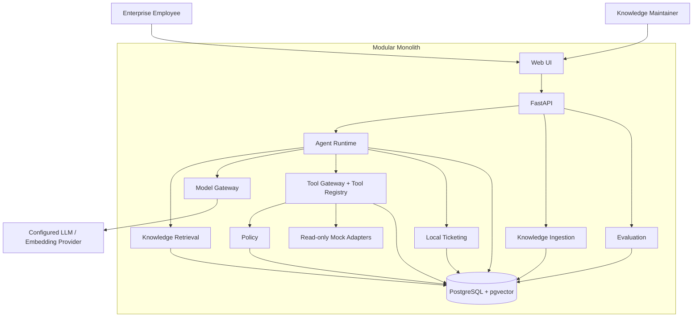
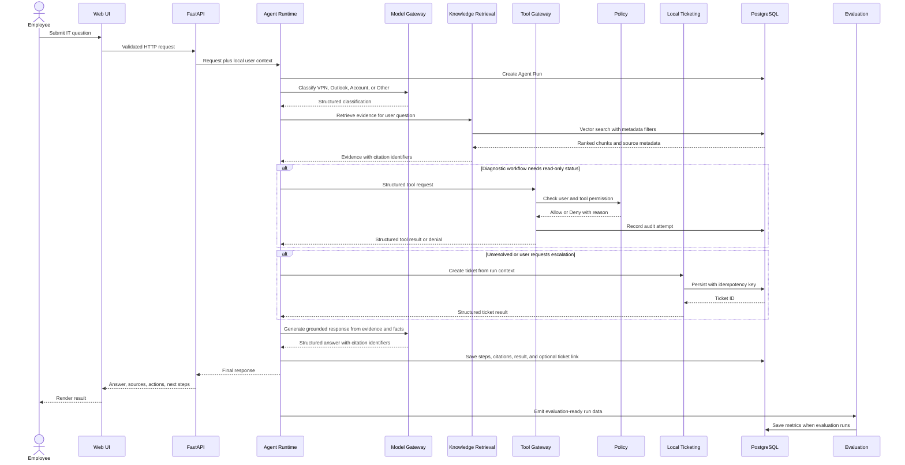
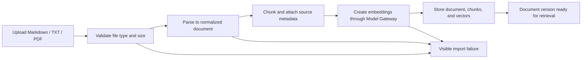

# Enterprise IT Support AI Agent：MVP 架构

## 1. 架构结论

MVP 采用模块化单体架构：一个 FastAPI 应用承载 Web、请求编排、知识检索、工具治理、本地工单和评估入口；后台文档导入和评估任务也复用相同的领域模块；PostgreSQL 与 pgvector 作为唯一持久化基础设施。

“单体”描述部署形态，不表示代码可以相互随意依赖。应用内部按业务能力划分深模块，每个模块通过小而稳定的 interface 协作。模块的实现细节、外部 SDK 和数据库查询不得泄漏给调用者。

## 2. 设计原则

1. **显式编排**：一次请求由 Agent Runtime 协调，重要步骤和状态可观察、可持久化、可测试。
2. **证据优先**：企业问题只能基于检索证据或受控工具结果回答；证据不足时明确说明限制。
3. **确定性治理**：身份、Schema、权限、风险、审计和数据写入由普通代码决定，不能交给 LLM 自行判断。
4. **所有工具走同一入口**：任何工具都必须经过 Tool Registry、参数校验、Policy 和 Audit。
5. **接口即测试面**：测试通过模块公开 interface 验证可观察行为，避免依赖模块内部实现。
6. **依赖注入**：Model、Embedding 和外部工具以 Adapter 注入；测试使用确定性的本地 Adapter。
7. **渐进复杂度**：先构建可验证的 RAG 闭环，再把三类诊断流程放入 LangGraph 状态图。

## 3. Mermaid 架构图

以下图可直接复制到支持 Mermaid 的 GitHub README：

图中的箭头表达允许的主要调用方向。Web UI 不直接访问数据库，Agent Runtime 不绕过 Tool Gateway 调用 Adapter，LLM Provider 也不能直接访问 Tool Gateway 或数据库。

## 4. 模块职责与主要 interface

这里的 interface 不仅指函数参数，还包含调用顺序、校验规则、错误模式和可观察结果。

| 模块 | 核心职责 | 对调用者公开的主要能力 | 不应泄漏的实现细节 |
| --- | --- | --- | --- |
| Web UI | 提问、展示流式状态、引用、工单和导入结果 | 提交请求、上传文档、查看结果、提交反馈 | 数据库表、Prompt、模型 SDK |
| FastAPI | HTTP 输入验证、请求上下文、错误映射、响应传输 | Web 路由、健康检查、请求/响应 Schema | 诊断规则、检索 SQL、模型调用细节 |
| Agent Runtime | 路由一次用户请求，维护状态和步骤，协调 RAG、工具与工单 | 处理请求、恢复 Run、返回结构化结果 | Graph 节点实现、Prompt 文本、Adapter SDK |
| Knowledge Ingestion | 解析 Markdown/TXT/PDF，规范化、切分、生成向量、写入文档版本 | 导入文档、查询导入状态 | PDF 解析器、Chunk 算法、批处理细节 |
| Knowledge Retrieval | 根据问题检索、排序并生成可引用证据 | 返回证据集合、分数、来源和检索诊断 | pgvector 查询、融合策略、重排实现 |
| Model Gateway | 统一模型调用、结构化输出、超时、版本和用量记录 | 生成回答、分类、Embedding、受约束的结构化推理 | 供应商 SDK、重试细节、密钥 |
| Tool Registry | 保存允许调用的工具定义及版本 | 按名称解析工具及其 Schema、风险和权限元数据 | Adapter 构造方式 |
| Tool Gateway | 统一校验、授权和执行工具，记录每次尝试 | 请求执行已注册工具并返回结构化结果 | 具体 Mock 数据源、审计存储查询 |
| Policy | 基于用户、工具和动作做确定性判定 | 返回 Allow 或 Deny 及原因 | 规则存储方式和规则匹配实现 |
| Local Ticketing | 创建和查询本地 IT 工单，关联诊断上下文 | 创建工单、查询工单 | SQL 和数据库模型 |
| Evaluation | 管理评估案例、运行指标、保存可比较结果 | 运行评估、读取报告 | Judge Prompt、批处理实现 |
| Persistence | 事务、Repository、迁移和数据库连接 | 由各业务模块内部使用的持久化 Adapter | 连接池和 SQLAlchemy 细节 |

### 4.1 关键 seam

- **Model seam**：生产配置的模型 Adapter 与测试用确定性 Adapter 均满足 Model Gateway 内部约定。
- **Tool seam**：Tool Gateway 只接受 Registry 中的工具定义；MVP 使用只读 Mock Adapter，未来真实 Adapter 不改变 Agent 的调用方式。
- **Persistence seam**：业务逻辑依赖 Repository 行为，不在 Agent 节点中编写 SQL。
- **Parser seam**：不同文件格式在 Ingestion 模块内部适配为统一的规范化文档，不把解析器类型暴露给后续检索模块。

这些 seam 用于隔离真实变化，而不是为每个函数增加一层抽象。

## 5. 一次用户请求的完整数据流

### 5.1 数据流步骤

1. **接入与验证**：FastAPI 校验输入长度、类型和本地用户上下文，生成 request ID。
2. **建立轨迹**：Agent Runtime 创建 Agent Run，并为后续步骤使用同一 run ID。
3. **请求识别**：Model Gateway 返回受 Schema 约束的类别、置信度和理由；确定性路由规则处理低置信度结果。
4. **知识检索**：Retrieval 生成查询向量，从 pgvector 获取候选 Chunk，并返回带稳定 citation ID 的证据。
5. **诊断编排**：对应工作流判断是否缺少信息、是否需要只读状态，以及是否具备回答条件。
6. **受控工具调用**：Tool Gateway 从 Registry 解析工具，校验参数，调用 Policy，写审计后才可执行 Mock Adapter。
7. **有依据生成**：Model Gateway 只能使用传入的证据和结构化工具结果生成回答，引用必须指向实际检索结果。
8. **保存结果**：系统在同一逻辑流程中保存步骤、引用、工具审计、最终答案和可选工单关联。
9. **评估回流**：Evaluation 使用已保存轨迹或版本化数据集计算指标，不阻塞普通用户请求。

## 6. 文档导入数据流

导入以文档版本为单位。只有完整处理成功的版本才进入可检索状态，避免用户检索到半导入数据。重新导入不会覆盖历史来源，而是生成新版本并切换当前有效版本。

## 7. LLM 与确定性代码的职责边界

| 能力 | LLM 可以做 | 必须由确定性代码完成 |
| --- | --- | --- |
| 请求理解 | 识别语义、提取症状、建议分类 | 校验结构化输出、低置信度兜底、选择允许的工作流 |
| 检索 | 改写自然语言查询、辅助重排 | 文档状态过滤、数据库查询、引用 ID 生成、结果数量限制 |
| 回答 | 根据提供的证据组织自然语言 | 保证引用存在、限制可用上下文、无证据拒答规则 |
| 诊断 | 建议下一步问题或解释状态 | 状态转换、最大步骤数、结束条件、错误恢复 |
| 工具 | 从允许列表中提出工具及参数 | Registry 解析、Schema 校验、Policy、执行、超时和审计 |
| 工单 | 生成问题摘要和已尝试步骤 | 创建记录、字段约束、事务和 ID 生成 |
| 权限 | 可解释为什么可能需要某项信息 | 身份、权限和 Allow/Deny 决策 |
| 评估 | 作为一个辅助 Judge 给出评分和理由 | 数据集版本、确定性指标、阈值和发布结论 |

### 7.1 不可违反的执行规则

- LLM 永远不接收通用命令执行工具；
- LLM 生成的工具名和参数都视为不可信输入；
- Registry 外的工具无法执行；
- Policy 被拒绝后，Agent 只能解释或升级，不能改写参数规避规则；
- 工具执行成功、失败和拒绝都必须产生审计记录；
- 引用只能来自当前 Run 实际检索到的证据；
- 模型密钥只来自环境变量，不能写入数据库、源码或日志。

## 8. 持久化范围

MVP 使用同一个 PostgreSQL 实例，但按领域拥有数据：

| 数据类别 | 主要记录 |
| --- | --- |
| Knowledge | 文档、文档版本、Chunk、Embedding、导入状态、来源元数据 |
| Conversation | 会话、用户消息、助手消息 |
| Agent | Run、Step、状态、模型与 Prompt 版本、错误 |
| Tools | 工具定义版本、执行尝试、Policy 决策、结构化结果摘要 |
| Tickets | 本地工单、状态、诊断摘要、关联 Run |
| Evaluation | 数据集、案例、评估 Run、逐项结果、聚合指标 |

共享数据库不意味着跨模块直接修改表。每个模块通过自己的 Repository 实现维护数据写入规则；需要跨模块关联时使用稳定 ID 和显式编排。

## 9. 错误、安全与可观察性

### 9.1 错误处理

- 用户可修复错误：返回可操作提示，例如不支持的文件格式；
- 外部依赖错误：记录失败步骤并返回暂时不可用，不伪造结果；
- 模型输出无效：有限次数重试结构化输出，然后进入安全兜底；
- 工具被拒绝：保存审计并向 Agent 返回稳定的拒绝结果；
- 数据写入失败：不得向用户声称工单或操作已成功。

### 9.2 最小安全控制

- 文件类型、大小和解析超时限制；
- 请求和模型输出 Schema 校验；
- 本地角色与最小权限 Policy；
- Tool allowlist；
- 环境变量管理密钥；
- 日志和审计中的敏感字段脱敏；
- Prompt injection 测试案例；
- 禁止任意命令、代码和 SQL 执行。

### 9.3 可观察性

每次请求至少携带 request ID 和 agent run ID。模型调用、检索、工具、Policy、工单和评估结果都能通过 run ID 关联。MVP 先实现结构化日志和数据库轨迹，后续可在不改变领域 interface 的前提下增加更完整的遥测导出。

## 10. 测试策略

- **单元测试**：分类兜底、Chunk 规则、引用验证、Policy、Tool Registry、参数 Schema、工作流转换和评估指标；
- **集成测试**：PostgreSQL/pgvector Repository、三种格式导入、检索、工具审计、本地工单；
- **端到端测试**：从 Web/API 请求到带引用回答，以及未解决问题创建工单；
- **评估回归**：版本化案例验证 Hit@5、分类、引用、安全拒答、工具选择和诊断完成率；
- **安全测试**：未注册工具、非法参数、越权请求、提示注入和引用伪造。

模块公开 interface 是主要测试面；测试验证可观察结果，而不是绑定内部函数调用顺序。
