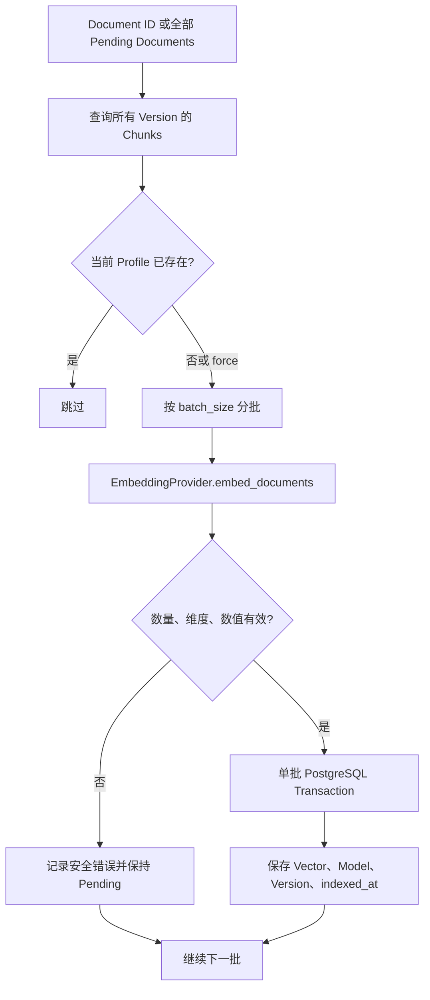

# Embedding 与 pgvector 索引设计

本文描述 Phase 3 已实现的 Chunk Embedding 生成和持久化流程。它不包含最终知识检索接口，也不包含 RAG 回答。

## 1. Embedding 是什么

Embedding 是把一段文本转换为固定长度浮点数向量的过程。语义接近的文本，在同一个 Embedding Profile 中通常会得到距离更近的向量。

OpenAI Embeddings API 接受单个字符串或字符串数组，返回带输入顺序 index 的浮点向量；`text-embedding-3` 及后续模型支持通过 `dimensions` 选择输出维度。项目使用官方异步 Python SDK 调用该接口，但测试环境只允许 Fake Provider。参考：[OpenAI Embeddings API](https://developers.openai.com/api/reference/resources/embeddings/methods/create)、[OpenAI Embeddings guide](https://developers.openai.com/api/docs/guides/embeddings)。

## 2. 为什么 Chunk 需要转换成向量

关键词匹配要求用户和文档使用相同词语，而向量可以表示更接近语义层面的关系。例如“VPN 一直超时”和“远程连接无法建立”没有完全相同的词，但可能处于相近向量空间。

向量属于具体 Chunk，而不是整个 Document：

- 一个 Document 可能很长，单个文档向量会丢失局部细节；
- Chunk 已保存标题、原文件名、行号或页码；
- 将来检索返回 Chunk 时，可以直接构造来源引用；
- Chunk 属于不可变 Document Version，历史引用可以复现。

## 3. Embedding Profile

本项目用三个值识别一个兼容向量空间：

- `embedding_model`：模型或 OpenAI-compatible 模型名称；
- `embedding_dimension`：向量长度；
- `embedding_version`：应用控制的索引版本。

只有 Profile 完全相同的向量才能直接比较。即使模型名称没有变化，只要前处理规则、SDK Adapter 行为或业务索引策略发生变化，也可以提高 `embedding_version` 触发重新索引。

## 4. pgvector 如何保存向量

Alembic migration `20260719_0003` 为 `document_chunks` 增加：

- `embedding`：pgvector `vector`；
- `embedding_model`；
- `embedding_version`；
- `indexed_at`。

数据库约束要求四个字段要么全部为空，要么全部存在，防止出现“有向量但不知道由哪个模型生成”的不完整状态。

当前列使用可变维度 `vector`，实际维度由 Indexing Service 在写入前严格校验，并在状态查询时使用 PostgreSQL `vector_dims()` 再次核对。这样 Fake Provider 可以使用小维度，真实 Provider 也能通过配置替换。

Phase 3 已通过 pgvector cosine distance 查询验证向量可存储和排序，但没有对外提供检索 API，也没有创建 HNSW/IVFFlat 近似最近邻索引。近似索引依赖最终确定的维度、距离算子和查询过滤条件，应与知识检索一起设计。

## 5. 索引流程



每个 Provider batch 使用一个独立数据库事务。某批失败时，已成功提交的前序批次不会回滚；失败 Chunk 仍是 pending，下一次执行只补这些 Chunk。

日志只记录 Document ID、batch start、batch size 和异常类型，不记录 Chunk 内容、API Key 或外部 Provider 异常正文。

## 6. 重复执行与强制重索引

默认执行时，以下条件全部满足的 Chunk 会被跳过：

- 已有 embedding；
- `embedding_model` 与当前配置一致；
- `embedding_version` 与当前配置一致；
- 数据库实际向量维度与配置一致。

API 或 CLI 指定 `force=true` 时，会重新生成该 Document 所有 Chunks 的当前 Profile 向量。写入更新原 Chunk 行，不创建重复向量记录。

## 7. 文档更新后如何处理旧向量

Phase 2 的 Document Version 不可变。内容变化时会创建新的 Version 和新的 Chunk 行：

1. 旧 Version、旧 Chunks 和旧向量继续保留；
2. 新 Version 的 Chunks 初始为 pending；
3. 再次索引同一 Document 时，旧的当前向量被跳过，只处理新 Chunks；
4. 未来 Knowledge Retrieval 必须过滤有效或最新 Version，不能仅凭向量距离返回过期内容。

保留旧向量有利于审计和历史引用复现；是否清理历史向量属于后续数据保留策略，不在本阶段执行。

## 8. Provider 与安全配置

测试和本地演示默认使用 `FakeEmbeddingProvider`，它基于 SHA-256 产生稳定向量，不访问网络。

真实运行可以配置 `OpenAIEmbeddingProvider`：

```dotenv
IT_SUPPORT_EMBEDDING_PROVIDER=openai
IT_SUPPORT_EMBEDDING_MODEL=text-embedding-3-small
IT_SUPPORT_EMBEDDING_DIMENSION=1536
IT_SUPPORT_EMBEDDING_VERSION=v1
IT_SUPPORT_EMBEDDING_API_KEY=replace-in-local-env-only
```

API Key 只允许出现在被 Git 忽略的本地 `.env` 或部署环境变量中。test 环境从 Settings 层拒绝 OpenAI Provider，因此测试不会意外产生真实外部调用或费用。

## 9. 使用入口

单文档 API：

```text
POST /knowledge/documents/{document_id}/index
GET  /knowledge/documents/{document_id}/index-status
```

CLI：

```bash
python -m scripts.index_documents
python -m scripts.index_documents --document-id <uuid>
python -m scripts.index_documents --document-id <uuid> --force
```

CLI 默认处理所有 pending/stale Documents；只要存在失败 Chunk，就以非零状态退出，但已成功批次仍保留。
