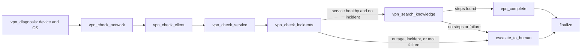
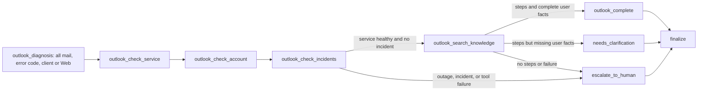
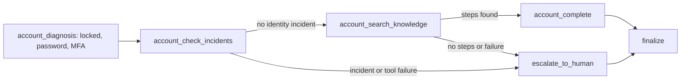

# Phase 7 Report：VPN、Outlook、账号诊断与只读工具

## 结论

**工程 PASS；总体 CONDITIONAL PASS（学习验收待完成）。** Phase 6 的三个 diagnosis placeholder 已替换为显式 LangGraph 状态图；七个工具全部是确定性 Mock 只读 Adapter。所有工具调用都经过 Tool Registry、严格输入/输出 Schema、Role Permission Policy、单次 timeout、有限 retry、错误清洗和 ToolExecutionGateway，并同时写入 AgentState observation 与 PostgreSQL `tool_executions`。

本阶段没有连接企业账号、VPN、邮件、设备、事件或知识系统，没有 Shell、Python、SQL、任意函数调用、工单写入或其他真实系统修改。

## 验收矩阵

| 要求 | 实现证据 | 验证 |
| --- | --- | --- |
| 完整 ToolDefinition | `tools/contracts.py` 的 10 个指定字段 | 七个定义字段完整性测试 |
| Tool Registry | 只注册 allowlisted、无副作用工具；拒绝重复和 side effect | Registry/Gateway unit tests |
| 唯一 Gateway | Runtime 只持有 `ToolExecutionGateway`，不持有 Registry/Adapter | Runtime composition 与范围扫描 |
| 参数 Schema | 每个输入和输出都是 strict、`extra=forbid` 且字符串有界的 Pydantic Schema | 非法参数、类型强制转换、非法输出和超限步骤测试 |
| 权限 | RolePermissionPolicy 检查 definition required permissions | permission denied 不调用 Adapter |
| timeout/retry | 每次 attempt timeout；仅 timeout/transient 可有限 retry | 两次 timeout 封顶、一次 transient 后成功 |
| 结构化结果 | observation/error/status/attempts/latency 固定结构 | Gateway interface tests |
| 错误清洗 | 不返回或保存 Adapter exception 正文 | fictional secret regression |
| 调用记录 | migration `20260723_0008` 与 ToolExecutionRepository | PostgreSQL success/invalid/denied test |
| 七个 Mock 工具 | account/mail/VPN/device/network/incidents/knowledge | exact registered-name test |
| VPN 状态图 | OS、公网、client、service、incident、knowledge/escalation | workflow 与 outage routing tests |
| Outlook 状态图 | all-mail、error code、client/Web、service、account、knowledge/escalation | complete 与 clarification tests |
| 账号状态图 | locked、password expiry、MFA、identity incident、knowledge/escalation | status 与 incident tests |
| observation 可追溯 | `tool_results` checkpoint state + `tool_executions` audit | POST/GET Agent Run readback |
| 最大工具次数 | `agent_max_tool_calls` 独立上限 | limit 后只升级、不再调用 |
| 失败安全升级 | Gateway/audit/node timeout failure 不由 graph 无限重试或覆盖 | Adapter、audit、late Gateway、诊断节点 timeout regression |

## ToolDefinition 与执行路径

`ToolDefinition` 包含：

- `name`
- `version`
- `description`
- `input_schema`
- `output_schema`
- `required_permissions`
- `risk_level`
- `has_side_effect`
- `timeout_seconds`
- `retry_policy`

```text
Agent diagnostic node
→ ToolExecutionGateway.execute(tool name, arguments, context)
→ ToolRegistry allowlist
→ input Schema
→ RolePermissionPolicy
→ timeout + finite retry
→ read-only Mock Adapter
→ output Schema
→ sanitized structured ToolExecutionResult
→ PostgreSQL tool_executions
→ AgentState.tool_results observation
→ deterministic next node
```

未注册、参数非法和越权请求在 Adapter 前终止；timeout 和瞬时失败只按 ToolDefinition 的有限策略重试；永久异常和非法输出立即失败。Gateway 不把原始日志或 exception 正文传给 Agent。

## 三类明确状态图

### VPN



### Outlook



### 账号



每个图都受 Phase 6 的 node attempt、recursion、node timeout 和 total timeout 保护，并额外受 `agent_max_tool_calls` 保护。Gateway 内部 retry 不会变成无限图循环。

## 关键实现

- `src/enterprise_it_support/tools/contracts.py`：ToolDefinition、retry、request/result/audit 合同；
- `src/enterprise_it_support/tools/gateway.py`：Registry、Policy、Gateway、清洗和有限执行；
- `src/enterprise_it_support/tools/mock.py`：七个严格 Schema 与统一 Mock 环境；
- `src/enterprise_it_support/tools/models.py`、`persistence.py`：tool execution audit；
- `src/enterprise_it_support/agent_runtime/runtime.py`：三类显式状态图和 observation 条件路由；
- `migrations/versions/20260723_0008_add_tool_executions.py`；
- `apps/dependencies.py`、`apps/api/main.py`：Mock tools composition；
- Agent API：同时返回 state `tool_results` 和持久化 `tool_executions`。

## 验证结果

- 开发前 Phase 6 基线：`164 passed in 6.56s`；
- Phase 7 首次全量：`180 passed in 8.37s`；
- 文档与普通 wheel 安装后的最终全量：`180 passed in 8.68s`；
- 收尾修复后最终全量：`186 passed in 8.53s`；
- 收尾 Gateway/Runtime 聚焦：`39 passed in 1.47s`；
- 收尾 Ruff：`All checks passed!`，`108 files already formatted`；
- 全部 unit：`91 passed in 1.47s`；
- Gateway/Registry：`7 passed in 0.05s`；
- Agent API：`7 passed, 38 deselected in 1.61s`；
- Tool audit、migration、Agent persistence 聚焦：`5 passed in 0.45s`；
- migration：test DB `0008 → 0007 → 0008` 成功；
- 开发库与测试库：`20260723_0008 (head)`；
- 真实 composition-root Mock smoke：
  - VPN：200/completed，5 calls/5 audit rows，10 个图节点；
  - Outlook：200/completed，4 calls/4 audit rows，9 个图节点；
  - Account：200/completed，3 calls/3 audit rows，7 个图节点。
- 收尾正式 composition-root 三场景：
  - 正常 VPN：200/completed，5 calls，5 个 succeeded executions；
  - 权限不足：200/escalated，1 个 permission_denied execution；
  - 最大工具调用次数：200/escalated，2 个 succeeded executions 后停止。

## 收尾代码审查

- 已修复 Blocking：诊断节点异常或节点级 timeout 产生的失败状态，不再被后续节点清除并覆盖为 completed；所有诊断条件边同时检查 `error` 和 `escalation_reason`；
- 已修复 Important：Mock Tool Schema 启用 Pydantic strict mode，对枚举保留显式 JSON 字符串解析，并给全部输出字符串及知识步骤元素设置上限；
- 已补齐 Important 测试：重复注册、side-effect 注册、非法/可强制转换输出、超限步骤、审计存储不可用、晚发 Gateway 异常和诊断节点 timeout；
- 未发现提前实现 Phase 8、真实 Adapter、写工具或任意函数执行；
- Optional 未处理：拆分 1,100 行 Runtime、抽取重复 graph registration、单独增加 Outlook Web parser 用例。

## 安全边界与延后项

- `user_role` 仍由请求自报，只是本地演示 Policy context，不是可信认证；
- Mock observations 是虚构本地事实，不代表任何真实企业状态；
- 工具输入会做常见 secret-shaped key 脱敏，但首要规则仍是不得主动提交密钥；
- Agent checkpoint、Step snapshots 和 tool audit 会保存用户问题、结构化参数与 observations；生产前仍需租户、保留、加密和删除策略；
- 本阶段没有真实 Adapter、写工具、审批、工单、命令执行或 Web UI；
- Outlook 用户事实提取是确定性演示规则，未知值会请求澄清；
- 如果唯一 PostgreSQL 审计存储本身不可用，Gateway 会停止并升级，但无法把该数据库故障写回同一数据库。

## 下一阶段边界

Phase 8 本地工单不在本次范围。未经项目所有者确认，不创建工单表、写操作、审批或真实企业 Adapter。

本阶段建议 Commit：`fix(agent): close phase 7 diagnostic safety gaps`。学习验收完成后建议 Tag：`phase-7-complete`。
